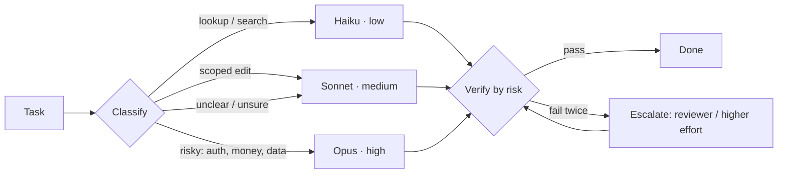

# AI Routing: from Junior to GOAT in Claude Code

You commented **ROUTER** under *AI LEVELS · EP 01*. This is the guide and starter kit behind it: how to stop running everything on the top model, and how to make Claude Code pick the model and effort for each task. It takes about 10 minutes to read, and every config here was run for real (see [Tested on](#tested-on)).

> **Check your version first:** `claude --version`. The model aliases move with Claude Code releases. `haiku` means Haiku 5.5 from **v2.1.293**, and `sonnet` means Sonnet 5.5 from **v2.1.284**. On older versions you get **Haiku 4.5**, which costs 10× more and has no effort setting, and **Sonnet 5**. Run `claude update`. Everything here was tested on **v2.1.311**; the first round ran on v2.1.280. [source](https://code.claude.com/docs/en/model-config#version-history)

---

## 0. TL;DR

**Routing** means sending each task to the cheapest model and effort level that reliably solves it, and checking the result in proportion to the risk.

**Two dials:**

| Dial | What it changes | Where you set it |
| - | - | - |
| **Model**: Haiku → Sonnet → Opus → Fable | Capability and price per token | `/model`, `--model`, the `model` setting, subagent `model:` |
| **Effort**: `low` → `medium` → `high` → `xhigh` → `max` | How much the model thinks and how many tool calls it makes | `/effort`, `--effort`, the `effortLevel` setting, subagent `effort:` |

**The GOAT setup in 5 bullets:**

1. Main session on **Sonnet at `medium`** as the orchestrator: [`templates/settings.json`](templates/settings.json).
2. Four subagents with a **fixed model + effort** in frontmatter: `code-searcher` (haiku · low), `implementer` (sonnet · medium), `test-runner` (haiku · low), `reviewer` (opus · high). They live in [`templates/.claude/agents/`](templates/.claude/agents/).
3. A **routing table in CLAUDE.md**: which task goes to which agent, "when unsure, use the middle tier", and "fails twice → reviewer": [`templates/CLAUDE.md`](templates/CLAUDE.md).
4. An **Opus advisor** that the cheap executor consults at decision points (`"advisorModel": "opus"`).
5. **One model per task** so the prompt cache survives, plus an optional hook that blocks any subagent spawn without an explicit model.

```bash
# install into your repo
cp -r templates/.claude your-repo/
cp templates/settings.json your-repo/.claude/settings.json   # or settings.with-hook.json
cat templates/CLAUDE.md >> your-repo/CLAUDE.md
```

### The three scripts: what they do and how to run them

| Script | What it does | Who runs it |
| - | - | - |
| [`templates/.claude/hooks/require-subagent-model.py`](templates/.claude/hooks/require-subagent-model.py) | Stops Claude Code from starting a subagent that has no model, so nothing silently inherits your expensive main model | **Claude Code**, automatically, before every subagent launch |
| [`examples/router.py`](examples/router.py) | A small router for your own API calls: Haiku labels the task, a table picks model + effort | **You**, from a terminal |
| [`examples/test_router.py`](examples/test_router.py) | Checks `router.py` offline, with no API key and no cost | **You**, from a terminal |

**1. The hook (optional, Claude Code only).** Needs Python 3.10+. `cp -r templates/.claude` above already copied the script; switching it on is one more file:

```bash
cp templates/settings.with-hook.json your-repo/.claude/settings.json   # settings.json + the hook entry
```

Then start Claude Code in `your-repo` as usual. You never run the hook yourself: Claude Code passes it each subagent launch as JSON. It allows the launch when the call names a `model` or when the agent's file in `.claude/agents/` has a `model:` line. Anything else is denied, and Claude reads the reason and retries with a model. Try it by hand:

```bash
cd your-repo
echo '{"tool_name":"Agent","tool_input":{"subagent_type":"code-searcher"}}' | python3 .claude/hooks/require-subagent-model.py
# (no output, exit 0) -> allowed: code-searcher.md has model: haiku

echo '{"tool_name":"Agent","tool_input":{"subagent_type":"Explore"}}' | python3 .claude/hooks/require-subagent-model.py
# {"hookSpecificOutput": {"hookEventName": "PreToolUse", "permissionDecision": "deny",
#   "permissionDecisionReason": "Subagent 'Explore' has no explicit model. Retry the Agent call with model set to
#   haiku (search, tests), sonnet (edits) or opus (risky review), or delegate to one of the routed agents in .claude/agents/."}}

echo '{"tool_name":"Agent","tool_input":{"subagent_type":"Explore","model":"haiku"}}' | python3 .claude/hooks/require-subagent-model.py
# (no output, exit 0) -> allowed: the call passes a model
```

In a real session you'll see a denied `Agent` call followed by a retry with `model: "haiku"`, which is tested in T11 and T14. Set `ROUTING_HOOK_LOG=/tmp/hook.jsonl` to log every launch the hook sees. Remove the `hooks` block from `.claude/settings.json` to turn it off.

**2. The router (outside Claude Code).** It uses your Anthropic API account, so it's billed per token and not to a Claude subscription. It runs two requests: one tiny Haiku classification, then the real answer.

```bash
python3 -m venv .venv && source .venv/bin/activate
pip install anthropic
export ANTHROPIC_API_KEY=sk-ant-...        # from console.anthropic.com
python examples/router.py "In one sentence: what does grep -rn TODO src/ find?"
```

Result: the first line is the route it picked, then the model's answer (run R1, 2026-11-06):

```
[lookup -> claude-haiku-5-5 @ low]
It recursively searches all files under the src/ directory for lines containing "TODO" ...
```

Other real routes: "rename a Python function used in 3 files safely" → `[edit -> claude-sonnet-5-5 @ medium]`; "risk of dropping a column on a payments table" → `[risky -> claude-opus-5-5 @ high]`. If Haiku's label isn't one of `lookup | edit | debug | risky`, the router prints `[unsure -> claude-sonnet-5-5 @ medium]`: when in doubt it falls back to the middle tier, never the cheapest. To change the routes, edit the `ROUTES` table at the top of the file.

**3. The router's test (offline).**

```bash
pip install anthropic pytest
cd examples && pytest -q
# ...  3 passed in 1.03s
```

It runs the real SDK client against a fake HTTP server, so it needs no key and costs nothing. It checks that risky tasks go to Opus at `high`, that a label like " Lookup\n" still routes to Haiku at `low`, that an unclear answer falls back to Sonnet at `medium`, and that the exact request bodies are right.

---

## 1. What is a router

A router is a rule that decides which model handles a task, at what effort, how hard to check the result, and what happens when the check fails.



The two rules that make it work:

- **When unsure, go to the middle tier.** Never send risky work to the cheapest tier.
- **Escalate the failing step, not the whole task.** Re-running everything on the big model throws away the savings.

### Cost math: cost per solved task, not price per token

List prices per 1M tokens on the Claude API, as of 2026-11-06 ([pricing](https://platform.claude.com/docs/en/about-claude/pricing)):

| Model | Input | Output | Cache hit | Cache write (5 min / 1 h) |
| - | - | - | - | - |
| Haiku 5.5 (prompt ≤ 100K) | $0.10 | $0.50 | $0.01 | $0.125 / $0.20 |
| Haiku 5.5 (prompt > 100K) | $0.50 | $2.50 | $0.05 | $0.625 / $1 |
| Haiku 4.5 (`haiku` on < v2.1.293) | $1 | $5 | $0.10 | $1.25 / $2 |
| Sonnet 5 (`sonnet` on < v2.1.284) | $2 | $10 | $0.20 | $2.50 / $4 |
| Sonnet 5.5 | $2 | $10 | $0.10 | $2.50 / $4 |
| Opus 5.5 | $4 | $20 | $0.20 | $5 / $8 |
| Fable 5.1 | $10 | $50 | $0.25 | $12.50 / $20 |

Cache hits cost 0.025× input on Fable 5.1, 0.05× on Opus 5.5 and Sonnet 5.5, and 0.1× on every other model. Cache writes cost 1.25× input for the 5-minute TTL and 2× for the 1-hour TTL.

**Worked example.** A bug fix that takes 30 model requests: 20 searches and test runs, 8 edits, 2 reviews.
*Assumptions:* every request carries 50K tokens of context (90% cache hits, 10% new content written to the 5-minute cache) and produces 2K output tokens. Real subagents start with smaller contexts, so this flatters JUNIOR.

| Setup | Requests | Cost |
| - | - | - |
| **JUNIOR**: all 30 on Opus 5.5 | 30 × $0.074 | **$2.22** |
| **GOAT**: 20 Haiku 5.5 + 8 Sonnet 5.5 + 2 Opus 5.5 | 20 × $0.002 + 8 × $0.037 + 2 × $0.074 | **$0.49** |
| **GOAT + escalations**: 5 extra Sonnet + 2 extra Opus retries | | **$0.82** |

The metric that matters is **cost per solved task**. Suppose JUNIOR solves 95% of tasks and GOAT only 90%. JUNIOR then costs $2.22 / 0.95 = **$2.34 per solved task**, and GOAT costs $0.82 / 0.90 = **$0.91**. A cheap model that fails silently costs more than either, which is why the verify step exists.
With v2.1.280's aliases (Haiku 4.5, Sonnet 5), the same GOAT run costs $0.90 before escalations and $1.25 with them. It is still cheaper, just less so.

On a subscription you don't pay per token, but every request draws on your session and weekly limits. Anthropic doesn't publish how much each model weighs against those limits. [source](https://code.claude.com/docs/en/costs#when-a-developer-asks-about-a-limit)

---

## 2. JUNIOR: everything on the top model at max

What it looks like:

- `/model opus` (or Fable), `/effort max`, and you never touch the dials again.
- Every subagent **inherits** that model. The built-in `Explore` and `general-purpose` agents run on the main conversation's model unless something else sets one. [source](https://code.claude.com/docs/en/sub-agents#built-in-subagents)
- A `/model opus` switch also reaches subagents that inherit, because Claude Code resolves their model when it starts them. [source](https://code.claude.com/docs/en/model-config#setting-your-model)

Why it burns limits:

- Grep-and-read work, which makes up most requests, gets billed at Opus rates.
- `max` "may show diminishing returns and is prone to overthinking". [source](https://code.claude.com/docs/en/model-config#choose-an-effort-level)
- Subagents count toward the same usage limits as the main conversation. [source](https://code.claude.com/docs/en/sub-agents)

**Tested:** with the main session on Sonnet 5 at `low`, the built-in Explore subagent ran on `claude-sonnet-5` at `low` (T12). It simply copies whatever you run.

---

## 3. MIDDLE: picking the model by hand

```text
/model sonnet        # switch model (also saves it as your default)
/effort medium       # low | medium | high | xhigh | max | auto
/model opusplan      # Opus in plan mode, Sonnet when executing
```

- `opusplan` runs **Opus during plan mode** and **Sonnet during execution**. [source](https://code.claude.com/docs/en/model-config#opusplan-model-setting)
- Claude Code's default model is **Opus 5.5** on Pro, Max, Ultra, Team, Enterprise and the API. Its default effort is **`medium`** on Opus 5.5, Sonnet 5.5 and Haiku 5.5, and `high` on every other model that supports effort. [source](https://code.claude.com/docs/en/model-config#adjust-effort-level)
- `max` is session-only unless you set it with `CLAUDE_CODE_EFFORT_LEVEL`.

**When this is enough:** short sessions, one kind of work per session, and you remember to switch.

**The cache cost of switching** (this is what EP 02 showed):

- **`/model` switch:** "Each model has its own cache. Switching with `/model` means the next request reads the entire conversation history with no cache hits." Each `opusplan` plan-mode toggle is also a model switch. [source](https://code.claude.com/docs/en/prompt-caching#switching-models)
- **Effort change:** on Opus 5.5, Sonnet 5.5, Haiku 5.5 and Fable 5.1, with an API key or a subscription, you keep the cache. On most other models, changing effort also loses it. [source](https://code.claude.com/docs/en/prompt-caching#changing-effort-level)
- **Subagents don't touch the parent's cache.** A subagent warms its own cache, and "the parent's cache is unaffected". [source](https://code.claude.com/docs/en/prompt-caching#subagents-and-the-cache)

**Tested (C2/C3):** I resumed the same session twice. On the same model, the next request read 34,835 cached tokens. After switching to Haiku, the next request read **0** and wrote all **37,659** tokens again.

So switching by hand works, but every switch costs one full uncached read of the conversation. Delegating instead (SENIOR) avoids that.

---

## 4. SENIOR: subagents with a fixed model and effort

Put the model and effort in the agent file so they don't depend on what the main session runs. Copy the four agents from [`templates/.claude/agents/`](templates/.claude/agents/):

| Agent | `model` | `effort` | `tools` | Job |
| - | - | - | - | - |
| [`code-searcher`](templates/.claude/agents/code-searcher.md) | `haiku` | `low` | Read, Grep, Glob | find files and usages; read-only |
| [`implementer`](templates/.claude/agents/implementer.md) | `sonnet` | `medium` | Read, Edit, Write, Bash, Grep, Glob | scoped edits |
| [`test-runner`](templates/.claude/agents/test-runner.md) | `haiku` | `low` | Bash, Read, Grep, Glob | runs tests, reports failures only |
| [`reviewer`](templates/.claude/agents/reviewer.md) | `opus` | `high` | Read, Grep, Glob, Bash | reviews risky diffs only |

```markdown
---
name: code-searcher
description: Finds files, symbols, usages and call sites. Read-only. Use proactively before any edit...
tools: Read, Grep, Glob
model: haiku
effort: low
---
You locate code. You never edit. ...
```

The fields (`name`, `description`, `tools`, `model`, `effort`, `color`) come from the [frontmatter reference](https://code.claude.com/docs/en/sub-agents#frontmatter-reference). Only `name` and `description` are required. `model` accepts `haiku`, `sonnet`, `opus`, `fable`, a full ID such as `claude-opus-5-5`, or `inherit`.

**Effort rules for subagents** ([source](https://code.claude.com/docs/en/sub-agents#choose-an-effort-level)):

- `effort` in frontmatter overrides the session's effort, but not `CLAUDE_CODE_EFFORT_LEVEL`.
- A subagent with no `effort` that runs on the main conversation's model uses the session's effort. On a different model, the session's level doesn't apply, so set `effort` explicitly.

**Tested:** each agent ran on its frontmatter model. On 2.1.280:

| Agent | Model that answered | Effort recorded |
| - | - | - |
| `code-searcher` | `claude-haiku-4-5-20251001` | none (Haiku 4.5 has no effort) |
| `implementer` | `claude-sonnet-5` | `medium` (session was `low`) |
| `test-runner` | `claude-haiku-4-5-20251001` | none |
| `reviewer` | `claude-opus-5-5` | `high` |

**On 2.1.311 (T15):** `code-searcher` and `test-runner` ran on `claude-haiku-5-5` at `low`, `implementer` on `claude-sonnet-5-5` at `medium`, and `reviewer` on `claude-opus-5-5` at `high`.

> **Haiku before v2.1.293:** the `haiku` alias gives you Haiku 4.5, and Claude Code silently drops `effort: low`. To get Haiku 5.5 today, set `model: claude-haiku-5-5`. That worked on 2.1.280, but Claude Code printed `[claude-code:unrecognized_model]` and couldn't price the run: it estimated $0.079 where list price is about $0.002. The clean fix is `claude update` to v2.1.293 or later, after which `haiku` means Haiku 5.5.

Check live which model a subagent is on with `/tasks` (v2.1.242+). [source](https://code.claude.com/docs/en/sub-agents#choose-a-model)

---

## 5. GOAT: the system routes, not the human

### 5.1 A routing table in CLAUDE.md

Append [`templates/CLAUDE.md`](templates/CLAUDE.md) to your project's CLAUDE.md:

```markdown
| Task type | Delegate to | Model · effort |
| - | - | - |
| Find files, symbols, usages, "where is X" | `code-searcher` | haiku · low |
| Scoped edit: feature, fix, refactor in a few files | `implementer` | sonnet · medium |
| Run tests, lint, build; report failures | `test-runner` | haiku · low |
| Review a risky diff: auth, payments, migrations, security, public API, concurrency | `reviewer` | opus · high |
| Anything else | `general-purpose` with `model: "sonnet"` | sonnet · session effort |

1. Every delegation names one of the agents above, or passes `model` explicitly.
2. When unsure of the tier, use the middle tier (sonnet). Never the cheapest tier on risky work.
3. Verify by risk: after every implementer edit, run test-runner. Reviewer only for the risky list.
4. Escalate, don't loop: same test fails twice → send diff + failure to reviewer, then implementer again.
5. Keep one model per task. Do not run /model mid-task; delegate instead.
6. Use the advisor before committing to a multi-file approach and before declaring a long task done.
```

**Tested (T13):** one prompt, "The tests in src fail. Fix it, following the routing rules in CLAUDE.md". The main session (Sonnet 5 · medium) delegated on its own to code-searcher (Haiku 4.5), then implementer (Sonnet 5 · medium), then test-runner (Haiku 4.5), and finally reviewer (Opus 5.5 · high). The tests passed.

### 5.2 Escalation rule

These are rules 3 and 4 in the table above. Claude follows CLAUDE.md as instructions; nothing enforces them mechanically. For a hard limit, add a hook (5.5).

### 5.3 Advisor: a cheap executor plus a strong advisor

The advisor is a server-side tool. Your main model works, and at decision points it asks a stronger model, which reads the whole conversation and returns guidance. [source](https://code.claude.com/docs/en/advisor)

```json
{ "advisorModel": "opus" }
```

The setting above makes it the default. You can also use `/advisor opus` or `/advisor off` in a session, or `claude --advisor opus` at launch (the flag isn't listed in `--help`).

- **Pairing rule:** the advisor must rank at or above your main model. Sonnet 5.5 accepts Fable or Opus 5+. Sonnet 5 accepts Fable, Opus 4.7+ or Sonnet 5+. Opus 5.5 accepts only Fable or Opus 5+. Haiku 4.5 can't act as an advisor. Haiku 5.5, as a main model or as an advisor, needs v2.1.293. [source](https://code.claude.com/docs/en/advisor#choose-an-advisor-model)
- **Requirements:** Anthropic API only, so subscriptions work but Bedrock, Vertex and Foundry don't. It also needs feature-flag fetching, so setting `DISABLE_TELEMETRY` turns the advisor off. `CLAUDE_CODE_DISABLE_ADVISOR_TOOL=1` disables it entirely.
- **Cost:** advisor tokens are billed at the advisor model's rates. On a subscription they count toward your limits (a Fable advisor may bill usage credits). Toggling the advisor keeps the main cache, but each advisor call re-reads the full transcript uncached.
- **You can't cap it in Claude Code:** "There is no setting to cap or force advisor calls". You can only steer it in your prompt. On the raw API the tool takes `max_uses` and `max_tokens`. [source](https://platform.claude.com/docs/en/agents-and-tools/tool-use/advisor-tool)

**Tested (T09, T13):** `--advisor opus` and `"advisorModel": "opus"` both worked on 2.1.280 with a Sonnet 5 main model. The transcript showed `advisor_message` iterations on `claude-opus-5-5`. Each call read **31K–42K input tokens with 0 cache hits**, about $0.13–$0.20 at list price. On these tiny test tasks, the advisor was the most expensive single line item. It pays off on long tasks, where it replaces running Opus throughout. On short tasks, leave it off.

### 5.4 Pin one model per task to keep the prompt cache

- The main session stays on one model. Different work goes to a subagent (its own cache) rather than through `/model` (a cold re-read of the whole conversation).
- A skill whose frontmatter names a different `model` is also a model switch for that turn. [source](https://code.claude.com/docs/en/prompt-caching#switching-models)
- Pin exact versions when you need reproducibility: `model: claude-opus-5-5` instead of `opus`.

### 5.5 Optional: block subagent spawns that have no explicit model

[`templates/.claude/hooks/require-subagent-model.py`](templates/.claude/hooks/require-subagent-model.py) is a `PreToolUse` hook on the `Agent` tool. It allows a spawn only when:

- the call itself passes `model`, or
- the agent's definition file has a `model:` line.

Anything else is denied, with a message telling Claude which model to pass. That covers built-in Explore and general-purpose agents without a model, and agent files with a typo in `model`. To enable it, use [`templates/settings.with-hook.json`](templates/settings.with-hook.json):

```json
"hooks": {
  "PreToolUse": [
    { "matcher": "Agent",
      "hooks": [ { "type": "command",
                   "command": "python3 \"${CLAUDE_PROJECT_DIR}/.claude/hooks/require-subagent-model.py\"" } ] }
  ]
}
```

**Tested (T11, T14):** the hook worked on 2.1.280. A code-searcher spawn was allowed. Spawns of `plain-helper` (an agent with no model) and built-in `Explore` were denied, and Claude retried with `model: "haiku"` on its own.
**Important:** the hook's `tool_input` only contains what the *call* passes (`subagent_type`, `prompt`, `description`, and `model` if given). The frontmatter model is **not** in it: code-searcher arrived with `model: null`. That's why the hook reads the agent file.
Agents defined in plugins or with `--agents` aren't found by the file lookup and will be denied. Add their names to the script if you use them.

---

## 6. Pitfalls

1. **Env vars that override everything:**
   - `CLAUDE_CODE_EFFORT_LEVEL` beats `/effort`, `--effort`, settings and subagent `effort:` frontmatter. **Tested (T07):** with it set to `high`, the implementer (`effort: medium`) and the main session (settings `low`) both ran at `high`.
   - `CLAUDE_CODE_SUBAGENT_MODEL` is only a **default**. Frontmatter `model` and the per-call `model` beat it. **Tested (T05):** with `=haiku`, the implementer still ran on Sonnet 5. Before v2.1.251 it overrode everything.
   - `CLAUDE_CODE_SUBAGENT_MODEL_FORCE=1` (v2.1.257+) forces the env var's model onto every subagent and ignores frontmatter. **Tested (T06):** the implementer ran on Haiku 4.5. Check your shell profile and the `env` block of every settings file for these. [source](https://code.claude.com/docs/en/env-vars)
2. **Model resolution order for subagents:** the per-call `model` parameter, then frontmatter `model` (`inherit` means the main model), then `CLAUDE_CODE_SUBAGENT_MODEL`, then the main model. If the alias matches the main model's family, the subagent runs on the main model's exact version. [source](https://code.claude.com/docs/en/sub-agents#choose-a-model)
3. **Frontmatter typos are silently ignored.** "Claude Code ignores a field it doesn't recognize without reporting an error." **Tested (T08):** an agent with `modle: haiku` and `efort: low` ran on the main model (Sonnet 5) at the session effort (`low`), with no warning. Since v2.1.296, `claude --debug` names unknown fields. On 2.1.280 the debug log said nothing. The hook in 5.5 catches a misspelled `model`.
4. **Re-running on the big model after a cheap fail.** That pays for both attempts. Escalate only the failing step (CLAUDE.md rule 4).
5. **Haiku 5.5's price jumps above 100K-token prompts:** $0.10/$0.50 becomes $0.50/$2.50, five times more. A Haiku subagent that reads half the repo stops being cheap. Keep its tasks narrow. [source](https://platform.claude.com/docs/en/about-claude/pricing)
6. **Cache misses:** `/model` switches, `opusplan` toggles, effort changes on older models, adding or removing MCP servers, and compaction all cost a full re-read. [source](https://code.claude.com/docs/en/prompt-caching#actions-that-invalidate-the-cache)
7. **Your saved defaults leak in.** `/model` writes the `model` key in `~/.claude/settings.json`, and `/effort` writes `modelSettings`. Project settings outrank user settings. `--model` and `ANTHROPIC_MODEL` outrank both. `/status` shows which files loaded.
8. **Aliases change under you** with every Claude Code update (see the note at the top). Pin full IDs where it matters.

---

## 7. Measure it

| Tool | What it shows |
| - | - |
| `/usage` (aliases `/cost`, `/stats`) | Session cost at list price, usage by model, a `Prompt cache (main)` line (v2.1.251+), and on subscriptions, plan usage bars plus attribution to subagents, skills and MCP servers. [source](https://code.claude.com/docs/en/costs#using-the-usage-command) |
| `/tasks` | The model and effort of each running subagent (v2.1.242+) |
| Status line | JSON with `cost.total_cost_usd` and a `prompt_cache` object. [source](https://code.claude.com/docs/en/statusline) |
| OpenTelemetry | `CLAUDE_CODE_ENABLE_TELEMETRY=1` and `OTEL_METRICS_EXPORTER=otlp` export the `claude_code.cost.usage` and `claude_code.token.usage` metrics; filter `query_source` = `subagent`. [source](https://code.claude.com/docs/en/monitoring-usage) |
| Headless JSON | `claude -p "…" --output-format json` gives `total_cost_usd` and `modelUsage` (per model, subagents included) |
| Transcripts | `~/.claude/projects/<dir>/<session>.jsonl` plus `<session>/subagents/agent-*.jsonl`. Observed on 2.1.280: every `assistant` entry has `message.model` and an `effort` field. This is undocumented and may change. |

**Before/after experiment on your own repo** (about 30 minutes):

```bash
# 1. Pick 5 real, small tasks with a checkable result (a failing test, a lint error, a small feature + test).
# 2. Baseline: your current setup. For each task, from a clean checkout:
claude -p "<task>. Run the tests at the end." --output-format json > before-$i.json
# 3. Install the templates (section 0), reset the checkout, run the same 5 tasks:
claude -p "<task>. Run the tests at the end." --output-format json > after-$i.json
# 4. For each run record: total_cost_usd, models in modelUsage, and whether the tests pass.
jq '{cost: .total_cost_usd, models: (.modelUsage | keys)}' after-*.json
```

Compute **cost per solved task** for each setup: total cost divided by the number of tasks whose tests pass. On a subscription, compare the `/usage` plan bars before and after each batch instead of dollars.

---

## 8. Bonus: routing outside Claude Code

[`examples/router.py`](examples/router.py) has about 30 lines of logic. Haiku 5.5 classifies the task into `lookup | edit | debug | risky`, a table maps each label to a model and effort, and anything unparseable falls back to the middle tier (Sonnet 5.5 · medium). It uses the official `anthropic` SDK with the current effort shape, `output_config={"effort": "low"}`. [source](https://platform.claude.com/docs/en/build-with-claude/effort)

```bash
pip install anthropic
export ANTHROPIC_API_KEY=...
python examples/router.py "Where is parse_date defined?"
# [lookup -> claude-haiku-5-5 @ low]
```

> **Run against the live API (R1, 2026-11-06, `anthropic` 2.6.0).** "What does `grep -rn TODO src/` find?" → `lookup → claude-haiku-5-5 @ low`. "Rename a Python function used in 3 files safely" → `edit → claude-sonnet-5-5 @ medium`. "Risk of dropping a column on a payments table" → `risky → claude-opus-5-5 @ high`. All three answers were correct.
>
> Offline, [`examples/test_router.py`](examples/test_router.py) drives the real SDK client (`anthropic` 2.6.0) through a fake HTTP transport and checks the exact request bodies: the model, `output_config.effort`, `thinking: {"type": "disabled"}` on the classifier, and the fallback. 3 of 3 pass. Run them with `pip install anthropic pytest && cd examples && pytest -q`.

When to use something else instead (each was checked to exist on 2026-11-06):

- **[LiteLLM proxy](https://docs.litellm.ai/docs/routing):** a self-hosted gateway with fallbacks, budgets, per-team keys and a beta [Auto Routing](https://docs.litellm.ai/docs/proxy/auto_routing) feature (heuristic or LLM classifier, then a model per tier). Use it when your team needs one endpoint, budgets and logs. Claude Code connects to it through `ANTHROPIC_BASE_URL`, but Anthropic doesn't support routing Claude Code to non-Claude models. [source](https://code.claude.com/docs/en/llm-gateway)
- **[OpenRouter Auto Router](https://openrouter.ai/docs/guides/routing/routers/auto-router):** send `model: "openrouter/auto"`. It classifies your prompt and picks a model based on community spend for that task type, with a `cost_tier` knob. Use it when you're fine sending traffic to a third party and to any vendor's models.
- **Managed routers such as [Not Diamond](https://docs.notdiamond.ai/docs/what-is-not-diamond):** a learned router trained on your evals. Use it when you have eval data and enough volume to justify a vendor.
- **The advisor tool on the API (`advisor_20260301`):** often enough on its own. A cheap executor plus a strong advisor inside a single request. [source](https://platform.claude.com/docs/en/agents-and-tools/tool-use/advisor-tool)

---

## Tested on

Claude Code **2.1.280**, then **2.1.311** (T15, T16, R1), macOS, Claude subscription, 2026-11-06. Runs were headless (`claude -p … --output-format json --setting-sources project,local`) in a scratch project; models and effort were read from `modelUsage` and the session JSONL. 17 runs, about $2.55 of API-equivalent usage.

| # | Config | Observed model(s) | Observed effort | Result |
| - | - | - | - | - |
| T01 | `settings.json`: `model: sonnet`, `effortLevel: low` | main `claude-sonnet-5` | `low` | pass |
| T02 | code-searcher + test-runner (`haiku`, `low`) | both `claude-haiku-4-5-20251001` | none (not supported) | pass (model), effort n/a |
| T03 | implementer (`sonnet`, `medium`) + reviewer (`opus`, `high`) | `claude-sonnet-5` / `claude-opus-5-5` | `medium` / `high` | pass |
| T04 | `CLAUDE_CODE_SUBAGENT_MODEL=haiku`, agent without `model` | `claude-haiku-4-5-20251001` | none | pass |
| T05 | same env var, implementer (`model: sonnet`) | `claude-sonnet-5` (frontmatter wins) | `medium` | pass |
| T06 | env var + `CLAUDE_CODE_SUBAGENT_MODEL_FORCE=1`, implementer | `claude-haiku-4-5-20251001` (forced) | none | pass |
| T07 | `CLAUDE_CODE_EFFORT_LEVEL=high`, implementer `effort: medium` | `claude-sonnet-5` | main `high`, subagent `high` | pass |
| T08 | frontmatter typo `modle: haiku`, `efort: low` | main model `claude-sonnet-5` | session `low` | ignored silently, no debug line |
| T09 | `--advisor opus`, main Sonnet 5 | `claude-sonnet-5` + `advisor_message` on `claude-opus-5-5` | `low` | pass (31K advisor input, 0 cached) |
| T10 | `--model claude-haiku-5-5` | `claude-haiku-5-5` | `low` | runs, but `unrecognized_model` and wrong cost estimate |
| T11 | hook, lab settings | code-searcher allowed, plain-helper denied, then retried with `haiku` | – | pass |
| T12 | built-in Explore, no model | `claude-sonnet-5` (inherits) | `low` (inherits) | pass |
| T13 | **all templates**: settings.json + CLAUDE.md + 4 agents + advisor | Sonnet 5 → Haiku 4.5 → Sonnet 5 → Haiku 4.5 → Opus 5.5; advisor Opus 5.5 | `medium` / – / `medium` / – / `high` | pass, tests green |
| T14 | **template** settings.with-hook.json, Explore | denied, then retried, `claude-haiku-4-5-20251001` | none | pass |
| C1–C3 | resume, same model vs `--model haiku` | Sonnet 5 → Haiku 4.5 | – | same model: 34,835 cached tokens read; after switch: 0 read, 37,659 rewritten |
| T15 | **2.1.311, all templates** + hook: searcher → implementer → test-runner → reviewer | main `claude-sonnet-5-5`; `claude-haiku-5-5`, `claude-sonnet-5-5`, `claude-haiku-5-5`, `claude-opus-5-5` | `medium`; `low` / `medium` / `low` / `high` | pass, $0.19 |
| T16 | **2.1.311**, resume with effort `medium` → `high`, same model | `claude-sonnet-5-5` | `high` | cache kept: 24,871 read, 541 written |
| R1 | `examples/router.py` against the live API | Haiku 5.5 classifier → Haiku 5.5 / Sonnet 5.5 / Opus 5.5 | `low` / `medium` / `high` | pass, 3 of 3 routed as intended |

**Not verified** (docs only, or not tested):
- `opusplan` and interactive `/model` and `/effort`: no interactive session was run. The switch cost was confirmed through resume + `--model` (C1–C3).
- The size of the weekly limit, and how much each model weighs against plan limits: not published.
- The Haiku 5.5 price above 100K-token prompts, OTel export, and the `/usage` screen: docs only.
- The per-call `effort` parameter on the Agent tool (v2.1.292+): available on 2.1.311, not tested. The templates set effort in frontmatter instead.
- LiteLLM, OpenRouter and Not Diamond: only checked that the docs exist and what they say.
- One test prompt full of random filler words got a false-positive safety refusal (`[bio]`) on Sonnet 5. If a long automated run suddenly stops, check for that.

---

## Sources (as of 2026-11-06)

- Model config, aliases, version history, effort: https://code.claude.com/docs/en/model-config
- Subagents, frontmatter, model order, effort: https://code.claude.com/docs/en/sub-agents
- Advisor in Claude Code: https://code.claude.com/docs/en/advisor
- Advisor tool on the API: https://platform.claude.com/docs/en/agents-and-tools/tool-use/advisor-tool
- Settings reference (`model`, `effortLevel`, `modelSettings`, `advisorModel`): https://code.claude.com/docs/en/settings-reference
- Settings files and precedence: https://code.claude.com/docs/en/settings
- Hooks (`PreToolUse`, Agent `tool_input`): https://code.claude.com/docs/en/hooks
- Environment variables: https://code.claude.com/docs/en/env-vars
- Prompt caching in Claude Code: https://code.claude.com/docs/en/prompt-caching
- Costs, `/usage`, limits: https://code.claude.com/docs/en/costs
- Commands (`/cost`, `/tasks`, `/effort`): https://code.claude.com/docs/en/commands
- CLI flags (`--effort`, `--advisor`, `--setting-sources`): https://code.claude.com/docs/en/cli-reference
- Status line fields: https://code.claude.com/docs/en/statusline
- OpenTelemetry metrics: https://code.claude.com/docs/en/monitoring-usage
- LLM gateways: https://code.claude.com/docs/en/llm-gateway
- Pricing: https://platform.claude.com/docs/en/about-claude/pricing
- Effort parameter (`output_config.effort`): https://platform.claude.com/docs/en/build-with-claude/effort
- Models overview: https://platform.claude.com/docs/en/about-claude/models/overview
- LiteLLM routing and Auto Routing: https://docs.litellm.ai/docs/routing · https://docs.litellm.ai/docs/proxy/auto_routing
- OpenRouter Auto Router: https://openrouter.ai/docs/guides/routing/routers/auto-router
- Not Diamond: https://docs.notdiamond.ai/docs/what-is-not-diamond

**About `templates/settings.json`:** JSON can't hold comments, so the footer lives here rather than in the file. The published settings schema does allow unknown keys, but adding one to a file Claude Code validates isn't worth the risk.

---

*by @donimas · AI Levels series*
